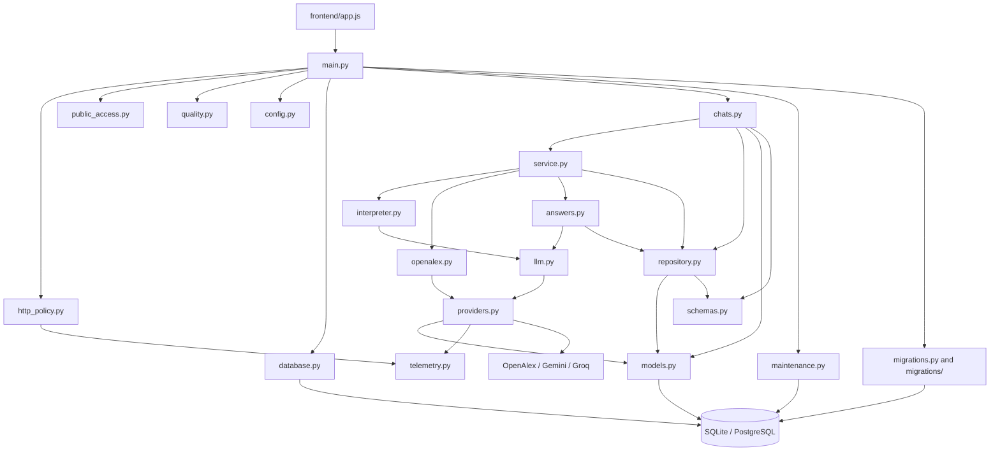
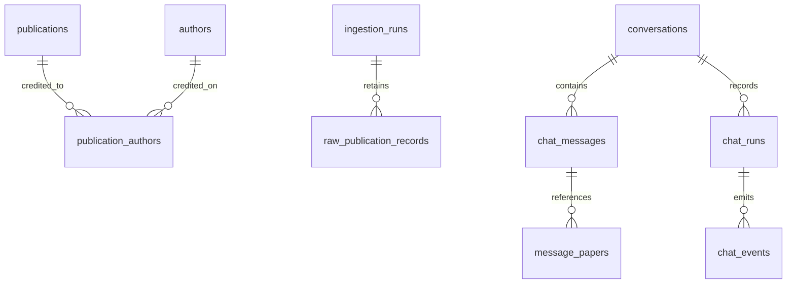

# Code map

Start here. Select the relevant row, confirm callers with `rg`, and read only that slice.
Update this map when interfaces, dependencies, tables, or test locations change.

## Ownership and contracts

- `main.py` builds the application. Startup holds a single-instance lock, backs up SQLite, runs
  versioned migrations, and recovers interrupted runs. Daily maintenance is awaited during shutdown.
- `database.py` enables SQLite foreign keys and busy timeouts. SQLite file locks and PostgreSQL
  advisory locks enforce one serving process per local database. Nested in-process tests may reuse
  the guard; that is not support for multiple production workers.
- `service.search_owned` is the live HTTP interface. Each database phase creates and closes its own
  SQLAlchemy session in a worker thread; provider I/O stays asynchronous. The original `search(session)`
  remains a direct test/tool adapter. Never move a session across threads.
- `repository.py` preserves raw JSON, validates fields, and upserts by provider identity. Author
  replacement is protected by the publication write lock. Unknown citation counts are `None`.
- `providers.request_json` uses a request-context shared runtime, one reusable HTTP client, bounded
  retries, response limits, provider semaphores, and durable daily usage. Standalone tools use a
  temporary client without application quota state; live HTTP routes always activate the runtime.
- `chats.py` owns topic claims, bounded context, indexed paper references, idempotency, and SSE.
  SQL operations are executed through owned worker sessions. It commits a result before completion
  is emitted and conservatively retains interrupted/failed runs. Stale claims expire after 120 seconds.
- Topic snapshots contain the latest 30 messages and `messages_before`. Older message pages carry
  related run summaries. Activity is paginated separately; only the latest relevant run is initially
  expanded into events. Provider IDs and literal titles resolve old references without full-history loads.
- `frontend/app.js` renders stable message/stage nodes, protects activation against stale responses,
  treats browser storage as optional, and reads the SSE stream incrementally. Dialog errors stay local.
- `answers.py` loads at most five abstracts of 4,000 characters, validates structured claims, IDs, and
  exact supporting quote membership, and falls back honestly. Quote membership does not prove entailment.
- `/api/search` retains results/clarification/answer responses; saved-chat commands also support inline
  details. Explicit controls override inferred filters; query-reuse controls bypass unnecessary planning.

## Find the affected slice

All backend paths below are relative to `backend/app/`.

| Task | Start | Related modules | Tests |
|---|---|---|---|
| Search/cache/fallback decisions | `service.py` | repository, schemas, openalex | data_pipeline, reliability, pipeline_hardening |
| Cleaning/identity/nulls/upserts | `repository.py` | models, schemas, migrations | reliability, pipeline_hardening, operations_hardening |
| Query planning/clarification | `interpreter.py` | schemas, providers, service | reliability, topics |
| Abstract evidence/citations | `answers.py` | repository, schemas, providers | topics, operations_hardening |
| Gemini response parsing/failure diagnostics | `gemini.py` | answers, interpreter, telemetry | test_gemini, topics |
| Gemini quota fallback to Groq | `llm.py` | interpreter, answers, providers, config, schemas, frontend modes | test_llm_fallback |
| Explicit live Gemini verification | root `scripts/diagnose_gemini.py` | config, providers, app routes, operations backup | test_gemini_diagnostic |
| Explicit live Groq verification | root `scripts/diagnose_groq.py` | shared provider-selectable route verifier in diagnose_gemini, config, providers | test_groq_diagnostic; at most two attempts; no quota resets |
| Shared HTTP/retry/quota | `providers.py` | config, models, telemetry | operations_hardening |
| Session/thread ownership | `service.py`, `chats.py` | main, database, answers | pipeline_hardening, operations_hardening |
| Saved chat/reference/paging/SSE | `chats.py` | models, main, frontend/app.js | chats, operations_hardening, frontend.test.cjs |
| Schema upgrade/rollback | `migrations.py`, root `migrations/` | models, database | topics, operations_hardening, local_release |
| Local policy/readiness/metrics | `main.py`, `http_policy.py` | telemetry, database, config | operations_hardening, local_release |
| Public browser ownership | `public_access.py`, `main.py` | config, Conversation.visitor_hash, migration 0003, frontend bootstrap | test_public_access; browser/public.spec.cjs |
| Retention/daily backup | `maintenance.py` | chats, models, scripts/operations.py | local_release, scripts/test_operations.py |
| UI behavior/style/accessibility | frontend files | response contracts | frontend.test.cjs, tests/browser/workspace.spec.cjs |
| Showcase recording/screenshots | `scripts/record_showcase.cjs` | scripts/showcase_server.py, showcase/ | --rehearse; recorded interaction assertions; video playback review |
| 60-second narrated demo edit | `scripts/build_demo.py` | scripts/render_demo_cards.cjs, docs/DEMO_STORYBOARD.md, original showcase footage | full audio/video decode, narration duration checks, source hash, playback metadata |
| Repeatable evaluation | `scripts/evaluate.py` | evaluation/README.md, reports | disposable benchmark and report integrity gates |
| Completeness definitions | `quality.py` | main, scripts/evaluate.py | test_portfolio_hardening |
| Synthetic acquisition fixture | root `scripts/synthetic_provider.py` | scripts/browser_server.py, scripts/evaluate.py | browser suites, test_portfolio_hardening |
| November 26 remediation | `repository.py`, `maintenance.py`, `http_policy.py` | quality, providers, telemetry, service | test_portfolio_hardening; docs/VERIFICATION.md |
| Dated readiness audit | PRODUCTION_READINESS_REPORT.md | DATA_QUALITY_REPORT.md, GAP_ANALYSIS.md, ENGINEERING_SCORECARD.md, evaluation/audits/2026-11-25/ | preserved logs, Graphify graph, reproducible isolated probes/load/recovery |
| Installation/CI/container | pyproject, locks, Dockerfile, compose | .github/workflows/ci.yml | local release_check.py; remote CI when connected |
| Clean publication export | root `scripts/prepare_release.py` | source allowlist, credential scan, .runtime/release-* | test_prepare_release |

Python tests live in `tests/test_*.py`. `tests/conftest.py` blocks unexpected external HTTP and
uses a replaceable mock transport responder to test changing upstream states with shared clients.
The Node DOM harness tests state transitions, not actual layout. Playwright runs real Chromium
with clearly labeled synthetic data in a disposable database; axe and screenshots supplement it.
PostgreSQL tests require `TEST_DATABASE_URL` and create/drop isolated schemas.

## Data graph

- `publications.openalex_id` is unique; DOI/title similarity is never a merge key.
- `raw_publication_records` is append-only source JSON with retrieval time. New records link to an
  ingestion run; historical unlinked records remain unknown rather than assigned invented lineage.
- Ingestion accounting: `received = rejected + valid`, and
  `valid = duplicates + excluded_dates + usable`. These measure different raw-entry/unique-ID stages.
- `search_cache` fingerprints validated retrieval fields, retains ordered logical work IDs, and
  rechecks TTL, full expected preview coverage, record availability, and date constraints.
- `chat_messages` retains result snapshots. `message_papers` indexes provider references and titles
  at message time. Its work IDs are logical references, so missing publications produce honest errors.
- `chat_events` is append-only, keyed by run and sequence. `chat_runs.events` remains an empty legacy
  compatibility field after migration; new code does not rewrite event arrays.
- `chat_runs` owns the command UUID, terminal outcome, process owner, and heartbeat. Conversation
  claims are conditional; admission is serialized across the one local process's worker threads.
- `daily_usage` atomically caps each resource per UTC date. Limits are persistent across restart.

See [README.md](README.md), [LEARNING_GUIDE.md](LEARNING_GUIDE.md), and
[operations](docs/OPERATIONS.md) for behavior, explanations, and recovery procedures.
