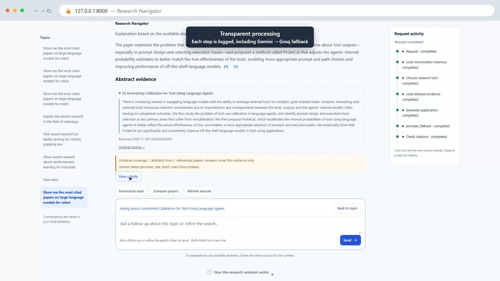
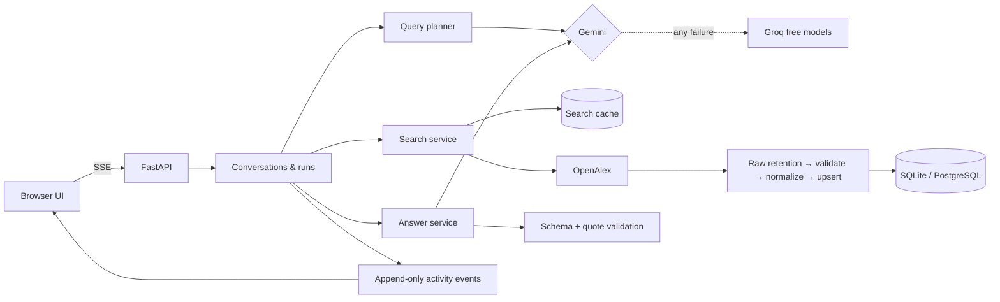

# Research Navigator

[](https://github.com/Sharan099/Research-Navigator/actions/workflows/ci.yml)
 

A conversational research-discovery workspace. Ask for publications in plain English, refine the
results in follow-up messages, and have an LLM explain or compare papers. Every claim is tied to a
quote that is checked against the paper's abstract.

Built with **FastAPI · Pydantic · SQLAlchemy · SQLite/PostgreSQL · vanilla JavaScript · Docker**, on
the [OpenAlex](https://openalex.org) scholarly graph, with **Gemini** as the primary LLM and
**Groq free models** as an automatic fallback.

## Demo (60 seconds)

[](docs/media/research-navigator-demo.mp4)

▶ [Watch the 60-second demo](docs/media/research-navigator-demo.mp4). This is a live session, not a mock-up:
the search comes from OpenAlex, the Gemini request fails with HTTP 429, and Groq's `gpt-oss-120b`
plans the query and writes the explanation. The only edit is that backend waits longer than two seconds are sped up.

| Step | What happens |
|---|---|
| 1. *"Show me the most cited papers on LLMs for robot task planning since 2022"* | The LLM turns the request into a validated query: terms, date range and ranking |
| 2. *"Only keep papers from 2023 onward about language agents that use tools"* | A follow-up refines the search, keeping the conversation's context |
| 3. Open a paper, then ask *"Explain this paper in simple terms"* | The answer may use only the stored abstract, and each claim cites an exact quote |
| 4. Click a citation | Shows the quoted abstract, its retrieval time and a link to the original source |
| 5. View activity | Shows each pipeline step, including the `provider_fallback` event (Gemini → Groq, with the reason) |

## Key engineering decisions

- **Raw data is never lost.** Every OpenAlex record is kept unchanged as append-only JSON, with its
  retrieval time and ingestion run. Normalized publications are upserted by provider ID, never by
  title similarity. Unknown values, such as a missing citation count, stay `NULL` and are never set to 0.
- **LLM output is untrusted input.** Query plans and answers must pass Pydantic schemas. Cited work IDs
  must belong to the papers supplied, and every quote must appear verbatim in the backend-loaded
  abstract. If the output fails these checks, the app shows the evidence alone and makes no claims.
- **Graceful provider degradation.** Gemini runs first. On *any* Gemini failure (quota, timeout, 5xx,
  auth, unusable output), the turn passes to Groq, which works through an ordered list of free models
  (`openai/gpt-oss-120b → openai/gpt-oss-20b`) and moves to the next model on 404/408/429/5xx. A shared,
  persistent daily AI-turn cap applies to both providers, so the fallback can't be used to get around it.
  Every switch shows up as a user-visible warning and as an activity event.
- **Honest caching and fallbacks.** The search cache records the fields each search depends on and
  rechecks TTL, completeness and date constraints before reuse. If OpenAlex is unavailable, the app
  falls back to the stored subset and says so in a warning.
- **Operational safety.** Provider calls share one HTTP client and use bounded retries, response-size
  limits, per-provider concurrency and durable daily quotas. Startup takes a single-instance lock,
  backs up SQLite, runs versioned migrations and recovers interrupted chat runs.

## Architecture



See [docs/ARCHITECTURE.md](docs/ARCHITECTURE.md) for contracts and the storage model, and
[CODE_MAP.md](CODE_MAP.md) for a module-by-module guide to the code.

## Quick start

**Docker**

```sh
cp .env.example .env          # add GEMINI_API_KEY and/or GROQ_API_KEY (both optional)
docker build -t research-navigator:local .
docker volume create research-data
docker run --rm -p 127.0.0.1:8000:8000 -v research-data:/data --env-file .env \
  -e DATABASE_URL=sqlite:////data/research_navigator.db research-navigator:local
```

**Local Python**

```sh
python -m pip install -r requirements.lock
cp .env.example .env
python -m uvicorn backend.app.main:app --host 127.0.0.1 --port 8000 --workers 1
```

Open <http://127.0.0.1:8000>. Without an LLM key, the app uses a visible rule-based planner. API keys
stay on the backend and are never sent to the browser. For PostgreSQL via Compose and the full list
of settings, see [docs/SETUP.md](docs/SETUP.md).

| Setting | Default | Purpose |
|---|---|---|
| `GEMINI_MODEL` | `gemini-3.5-flash` | Primary LLM |
| `GROQ_MODEL` | `openai/gpt-oss-120b,openai/gpt-oss-20b` | Ordered fallback models |
| `AI_TURNS_PER_DAY` | `3` | Shared cap across both LLM providers |
| `GEMINI_REQUESTS_PER_DAY` / `GROQ_REQUESTS_PER_DAY` / `OPENALEX_REQUESTS_PER_DAY` | `6` / `6` / `20` | Per-provider attempt caps (UTC day) |

## Testing

```sh
python -m pip install -r requirements-dev.lock
npm ci --ignore-scripts
pytest -q                  # 303 passed, 2 PostgreSQL tests skipped without TEST_DATABASE_URL
node --check frontend/app.js
npm test                   # Node DOM-state tests; Playwright browser suites in tests/browser
```

The Python suite blocks real network access and drives synthetic upstream responses. It covers
ingestion and normalization, cache reuse, provider failures and fallback order, quota accounting,
conversation isolation, migrations, and citation validation. To check providers live with an
explicit, capped budget, run `python -m scripts.diagnose_gemini --live` or `python -m scripts.diagnose_groq --live`.
Measurements and their dates are recorded in [docs/VERIFICATION.md](docs/VERIFICATION.md).

## Project layout

```text
backend/app/     FastAPI app: service, repository, chats, llm, providers, migrations
frontend/        Single-page UI (no build step)
migrations/      Versioned schema migrations
scripts/         Diagnostics, evaluation, release export, demo recording
tests/           pytest suite, Node DOM tests, Playwright browser suites
docs/            Architecture, setup, operations, verification, demo media
```

## Limitations

- This is a single-process prototype. It searches previews of OpenAlex and a partial local corpus,
  not all of OpenAlex.
- Answers are based only on available abstracts. A quote that matches the abstract shows the text
  exists there; it does not prove the claim follows from it, or that the science is correct.
- There is no authentication, scheduled corpus sync or trend dashboard. Free-tier LLM quotas are small
  by design.

## Documentation

| Document | Contents |
|---|---|
| [Architecture](docs/ARCHITECTURE.md) | Data flow, LLM placement, persistence, recovery |
| [Code map](CODE_MAP.md) | Where to start for each kind of change |
| [Setup](docs/SETUP.md) · [Operations](docs/OPERATIONS.md) | Configuration, backups, restores |
| [Verification](docs/VERIFICATION.md) | Test evidence and known gaps |
| [Learning guide](LEARNING_GUIDE.md) | Engineering concepts behind each change |

MIT-licensed application code. Source metadata keeps its own license; see the
[source registry](SOURCE_REGISTRY.md).
