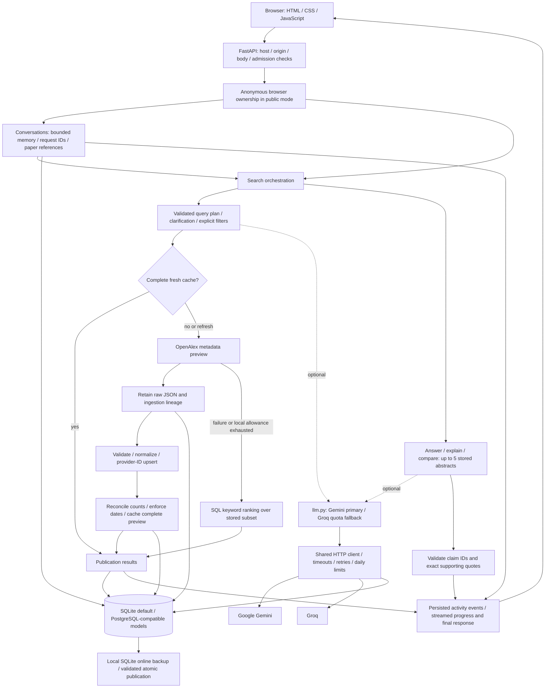

# Research Navigator

Find research papers, keep a conversation about a topic, and explore the available abstracts.
OpenAlex supplies publication metadata. Optional Google Gemini helps plan searches and write
explanations with checked supporting quotes. The app reads abstracts, not full papers.
When Gemini's provider budget or HTTP 429 quota is exhausted, a configured Groq key can take over.
Both providers' output is validated; failed citations never become accepted findings.

This is a learning project and public demo, not a production research or employee service.
See [release status](docs/DEPLOYMENT.md) for what has actually been verified or deployed.

## How to use it

1. Open the app and start a topic.
2. Ask a question such as “Find research on tactile sensing for robotic grasping since 2022.”
3. Adjust the date and sort controls, or ask a follow-up in the same chat.
4. Open paper details, explain one paper, compare selected papers, or summarize the topic.
5. Check the activity panel and supporting abstract quotes. Always check the original sources.

Public-demo chats belong to your browser cookie. Clearing cookies loses access. Free hosting
may erase all data on restart. Provider allowances are shared across visitors. If cookies are
blocked inside Hugging Face, use **Open application** to open the direct app URL.

## Run with Python

Use Python 3.11–3.13. From the project folder:

```text
python -m venv .venv
# Windows: .venv\Scripts\Activate.ps1
# macOS/Linux: source .venv/bin/activate
python -m pip install -r requirements.lock
python -m pip install --no-deps -e .
python -m uvicorn backend.app.main:app --host 127.0.0.1 --port 8001 --workers 1
```

Open http://127.0.0.1:8001. SQLite is created automatically. Copy `.env.example` to `.env`
to configure keys and limits. Keep `.env` private. `APP_MODE=local` is the default.

## Run with Docker

```text
docker build -t research-navigator:local .
docker volume create research-data
docker run --rm --name research-navigator -p 127.0.0.1:8000:8000 -v research-data:/data research-navigator:local
```

Open http://127.0.0.1:8000. The volume keeps your database between container runs.
To load backend keys, add `--env-file .env -e DATABASE_URL=sqlite:////data/research_navigator.db`
before the image name. Never bake keys into the image.

After a passing GitHub release publishes the image, you can replace the local image name with
`ghcr.io/sharan099/research-navigator:latest`. A commit tag gives a fixed version. The package
must be made public in GitHub package settings before anonymous pulls work.

For local PostgreSQL, run `docker compose up --build`. Compose binds ports to localhost.

## Hugging Face deployment

Create `sharan099/Research-Navigator` as a **public Docker Space** using free CPU hardware only.
This README sets the Docker SDK and port. Add these Space settings:

| Setting | Value |
|---|---|
| Variable `APP_MODE` | `public_demo` |
| Variable `PUBLIC_HOST` | The exact app hostname, for example `sharan099-research-navigator.hf.space` |
| Secret `SESSION_SECRET` | A securely generated random value of at least 32 characters |
| Optional secret `OPENALEX_API_KEY` | Your OpenAlex key |
| Optional secret `GEMINI_API_KEY` | Enable only after successful live Gemini verification |
| Optional secret `GROQ_API_KEY` | Groq quota fallback, backend only |
| Variable `GROQ_MODEL` | A Groq model verified for your account |
| Variable `GEMINI_MODEL` | A model verified for your account |

Do not upload a local database. Temporary Space storage is not a backup. No paid storage or
hardware is required by this project; platform account eligibility may still block free Docker creation.

Gemini generation is currently **unverified**: earlier requests timed out and the local AI-turn
budget was exhausted. With neither LLM configured, the app uses rules and shows stored evidence honestly.
To check your configured account without generation:

```text
python -m scripts.diagnose_gemini
```

Use `--live --max-attempts 4` only when you intend to spend provider attempts. The command respects
durable daily limits, uses a temporary research copy, and writes `.runtime/gemini-diagnostic.json`.
Default daily allowances are 3 AI turns, 6 Gemini attempts, and 20 OpenAlex attempts (UTC reset).
Groq has its own default limit of 6 attempts via `GROQ_REQUESTS_PER_DAY`. Set `GROQ_API_KEY` and
optionally `GROQ_MODEL` in your private `.env`; the example model is `llama-3.3-70b-versatile`.
`AI_TURNS_PER_DAY` is shared across Gemini and Groq. Exhausting that shared limit blocks both;
fallback does not reset counters or increase limits. Gemini timeouts, authentication errors,
invalid output and citation failures do not trigger quota failover. With only Groq configured,
Groq can act as the primary provider. Daily usage and result metadata identify the provider used.
Temporary hosting resets local counters when storage is lost; these are not provider billing guarantees.

## Push to GitHub

Follow the [step-by-step PowerShell guide](docs/GITHUB.md). It uses a credential-checked clean
export, reviews staged files, signs in through Git Credential Manager and pushes to your repository.
The guide lists files to include/exclude and explains GHCR publication of the smoke-tested image.
Keep `.env`, local data, virtual environments, caches, logs and recordings outside Git. Commit
`.env.example`, source, tests, lockfiles and CI so another person can reproduce the application.

Check Groq metadata and allowance with `python -m scripts.diagnose_groq`. Add
`--live --max-attempts 2` only to authorize generation checks. The latest metadata check passed,
but live generation stopped at the shared 3/3 daily AI-turn limit. No counters were reset.

## Architecture



OpenAlex also uses the shared provider HTTP runtime. `/api/search` returns JSON; saved-chat message
requests stream SSE activity. Source credentials stay in the backend. Local mode serves one personal
workspace; public mode adds anonymous browser ownership, not employee accounts or roles.

### How the data pipeline works

1. Pydantic validates the incoming request. Rules or an optional LLM produce a restricted search
   plan. Explicit UI filters override inferred filters. The plan is data, never executable SQL.
2. A SHA-256 fingerprint identifies the normalized search intent. Cache reuse requires a valid TTL,
   complete unique IDs, existing rows, and matching date/year bounds. Refresh bypasses reuse.
3. OpenAlex returns one bounded preview, not a full-corpus sync. The backend retains each raw entry,
   including malformed entries, with provider identity, retrieval time and the ingestion-run link.
4. The repository checks stored-field types, IDs, nonnegative citation counts and year/date agreement.
   It normalizes DOI values and reconstructs abstracts from word positions. Unknown fields stay null.
   Invalid records remain raw; they do not overwrite cleaned records. Titles never determine identity.
5. A transaction upserts publications by OpenAlex ID and replaces ordered author links. Repeated
   observations remain in raw storage. The run records received, valid, rejected, duplicate,
   date-excluded and usable counts. Only a complete preview becomes reusable cache state.
6. Source failures produce a visible warning and SQL-ranked local results. Ranking happens before
   the result limit. The stored subset cannot establish overall field coverage or that no paper exists.

Reconciliation uses `received = valid + rejected` and
`valid = duplicates + excluded_dates + usable`. A known year can satisfy a year-only filter without
inventing a day; an explicit day range requires a known publication date. These checks describe
engineering consistency, not independent verification of publisher facts.
The source-field reference is the [official OpenAlex work attributes](https://help.openalex.org/data/works/attributes/).

### Where the LLM is involved

| Stage | Input and output | Guardrail |
|---|---|---|
| Planning and clarification | User question plus bounded conversation context → search intent, priorities or clarification | Pydantic schema; allowed actions; UI filter precedence; rules fallback |
| Explain, summarize, compare | At most five stored abstracts, each capped at 4,000 characters → structured cited claims | Referenced IDs must belong to supplied evidence; supporting quotes must occur in the abstract excerpt |
| Provider selection | Gemini first; Groq if Gemini HTTP 429 or local Gemini allowance exhausted; Groq primary if Gemini absent | Shared AI-turn limit, separate provider-attempt limits; no quota failover after timeouts, auth failures or invalid citations |

The LLM does not clean canonical metadata, execute SQL, download PDFs, or classify a research corpus.
Exact quote membership does not prove semantic support or scientific truth. Invalid answers are
rejected and the user sees a safe fallback. Live generation remains unverified in the current evidence.

### Storage and recovery

| Tables | Purpose |
|---|---|
| `raw_publication_records`, `ingestion_runs` | Original observations, retrieval time, run outcomes and reconciliation counters |
| `publications`, `authors`, `publication_authors` | Normalized metadata, stable provider identity and ordered authorships |
| `search_cache` | Intent fingerprint, ordered work IDs, upstream match count and retrieval time |
| `conversations`, `chat_messages`, `chat_runs` | Saved state, result snapshots, idempotent turn IDs and recovery state |
| `chat_events`, `message_papers` | Durable timeline events and references for follow-up questions |
| `daily_usage` | UTC-day provider attempts and shared AI-turn allowances |

SQLAlchemy manages transactions; Alembic versions the schema. HTTP database phases own their
sessions inside worker threads; asynchronous provider waits do not retain a shared ORM session.
A single-instance guard requires one serving process. Interrupted chat work is recovered at startup;
the final result is committed before completion is streamed.

SQLite daily backups use an online snapshot, schema/integrity/foreign-key and snapshot-count checks,
then atomic publication. Invalid existing files are replaced; failed checks stop retention.
A valid same-day backup is reused, so it is not a backup of every subsequent write. Keep a separate
verified manual backup before upgrades. Chat retention defaults to 30 days; raw research observations
are not pruned. Off-device recovery and operational RTO/RPO are not established.

### Code and tool responsibilities

| Location | Responsibility |
|---|---|
| `backend/app/` | Request contracts, acquisition, transformation, persistence, AI, policy and telemetry |
| `frontend/` | Browser rendering, chat state, filters and streamed activity |
| `migrations/` | Versioned schema changes |
| `scripts/evaluate.py` | Read-only stored-data evaluation and isolated synthetic benchmark |
| `scripts/synthetic_provider.py` | Shared offline fixture for browser verification and benchmarks |
| `scripts/operations.py`, `scripts/postgres_backup.py` | Explicit backup/restore tooling |
| `scripts/release_check.py`, `scripts/prepare_release.py` | Local verification gates and credential-checked source export |
| `tests/`, `.github/workflows/` | Regression/browser verification and configured CI/release automation |

Use [CODE_MAP.md](CODE_MAP.md) to select a relevant code slice before searching. The older Graphify
audit graph is historical and predates later provider and public-access changes.

## Evidence and role alignment

Read the [current evaluation and remediation record](docs/VERIFICATION.md) and
[working-student role comparison](docs/ROLE_ALIGNMENT.md). Sanitized aggregate measurements are
retained in [evaluation/published/](evaluation/published/); private databases and raw logs stay ignored.
The November 25 audit documents remain dated evidence, with links to later remediation.

The project demonstrates ingestion, validation, SQL storage, provenance, backend development and
conversational exploration. Scheduled incremental ingestion, full-text classification, research-trend
dashboards, employee authentication and scientific-quality evaluation remain gaps. Passing local
tests does not make the application an operated internal platform or enterprise production system.

Measured November 26, 2026, on Windows/Python 3.13.7:

| Measurement | Result and scope |
|---|---|
| Regression | 293 Python tests passed; 2 PostgreSQL tests skipped; 94.17% combined statement/branch coverage |
| Frontend and operations | 34 Node tests, 6 Chromium browser journeys and 2 operations checks passed |
| Stored local corpus | 143 publications, 156 raw observations; provider provenance 143/143 |
| Integrity | 0 duplicate provider IDs, FK violations, year/date conflicts or tracked-run reconciliation failures |
| Completeness | Titles 141/143; abstracts 121/143; DOI 139/143; publication date 143/143 |
| Run lineage | 60/156 raw observations linked to runs; 6/18 runs have quality counters; older lineage is incomplete |
| Synthetic cached workload | 20/20 successful requests, 5 clients; P50/P95/P99 15.39/26.06/27.61 ms; 210.27 requests/s |
| Failure cases | Synthetic provider outage used local fallback; invalid input returned HTTP 422 |

The benchmark's 100% cache hit rate is deliberate fixture setup, not an observed production hit rate.
These small in-process timings do not demonstrate a speedup, sustained capacity or real-provider
latency. Zero stored claims means there is no current corpus-based hallucination or faithfulness
measurement. Docker, real PostgreSQL, remote CI and live LLM generation remain **NOT VERIFIED**.

## Development and tests

For the narrated 60-second portfolio demo, see the [storyboard and reproduction guide](docs/DEMO_STORYBOARD.md).
Generated video and screenshots stay in the local ignored `showcase/demo-60s/` folder.

```text
python -m pip install -r requirements-dev.lock
npm ci --ignore-scripts
pytest -q
node --check frontend/app.js
npm test
npx playwright install chromium
npm run test:browser
npm run test:browser:public
python scripts/evaluate.py --database research_navigator.db --benchmark --output evaluation/reports/current.json
```

Tests use isolated databases and synthetic provider responses. PostgreSQL tests require
`TEST_DATABASE_URL`; skipped tests are not successful PostgreSQL verification. CI tests Python,
PostgreSQL, browsers, dependencies and the container before publishing a GitHub image.

Read [CODE_MAP.md](CODE_MAP.md), [LEARNING_GUIDE.md](LEARNING_GUIDE.md), and
[operations](docs/OPERATIONS.md) to understand the code and recovery procedures.

MIT licensed application code. Research metadata and source content retain their own rights;
see [SOURCE_REGISTRY.md](SOURCE_REGISTRY.md).
