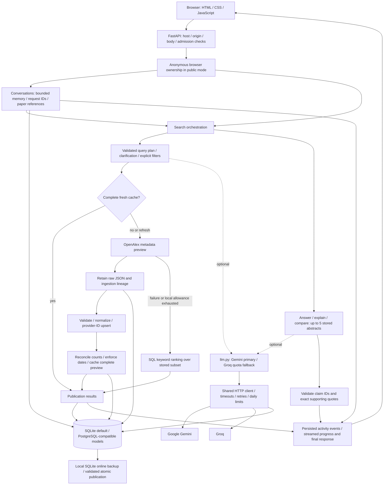

# Architecture

This reference describes the current implementation. For measured verification and deployment limits,
see [verification](VERIFICATION.md) and [deployment status](DEPLOYMENT.md).

OpenAlex also uses the shared provider HTTP runtime. `/api/search` returns JSON; saved-chat message
requests stream SSE activity. Source credentials stay in the backend. Local mode serves one personal
workspace; public mode adds anonymous browser ownership, not employee accounts or roles.

### How the data pipeline works

1. Pydantic validates the incoming request. Rules or an optional LLM produce a restricted search
   plan. Explicit UI filters override inferred filters. The plan is data, never executable SQL.
2. A SHA-256 fingerprint identifies the normalized search intent. Cache reuse requires a valid TTL,
   complete unique IDs, existing rows, and matching date/year bounds. Refresh bypasses reuse.
3. OpenAlex returns one bounded preview, not a full-corpus sync. The backend retains each raw entry,
   including malformed entries, with provider identity, retrieval time and the ingestion-run link.
4. The repository checks stored-field types, IDs, nonnegative citation counts and year/date agreement.
   It normalizes DOI values and reconstructs abstracts from word positions. Unknown fields stay null.
   Invalid records remain raw; they do not overwrite cleaned records. Titles never determine identity.
5. A transaction upserts publications by OpenAlex ID and replaces ordered author links. Repeated
   observations remain in raw storage. The run records received, valid, rejected, duplicate,
   date-excluded and usable counts. Only a complete preview becomes reusable cache state.
6. Source failures produce a visible warning and SQL-ranked local results. Ranking happens before
   the result limit. The stored subset cannot establish overall field coverage or that no paper exists.

Reconciliation uses `received = valid + rejected` and
`valid = duplicates + excluded_dates + usable`. A known year can satisfy a year-only filter without
inventing a day; an explicit day range requires a known publication date. These checks describe
engineering consistency, not independent verification of publisher facts.
The source-field reference is the [official OpenAlex work attributes](https://help.openalex.org/data/works/attributes/).

### Where the LLM is involved

| Stage | Input and output | Guardrail |
|---|---|---|
| Planning and clarification | User question plus bounded conversation context → search intent, priorities or clarification | Pydantic schema; allowed actions; UI filter precedence; rules fallback |
| Explain, summarize, compare | At most five stored abstracts, each capped at 4,000 characters → structured cited claims | Referenced IDs must belong to supplied evidence; supporting quotes must occur in the abstract excerpt |
| Provider selection | Gemini first; Groq if Gemini HTTP 429 or local Gemini allowance exhausted; Groq primary if Gemini absent | Shared AI-turn limit, separate provider-attempt limits; no quota failover after timeouts, auth failures or invalid citations |

The LLM does not clean canonical metadata, execute SQL, download PDFs, or classify a research corpus.
Exact quote membership does not prove semantic support or scientific truth. Invalid answers are
rejected and the user sees a safe fallback. Live generation remains unverified in the current evidence.

### Storage and recovery

| Tables | Purpose |
|---|---|
| `raw_publication_records`, `ingestion_runs` | Original observations, retrieval time, run outcomes and reconciliation counters |
| `publications`, `authors`, `publication_authors` | Normalized metadata, stable provider identity and ordered authorships |
| `search_cache` | Intent fingerprint, ordered work IDs, upstream match count and retrieval time |
| `conversations`, `chat_messages`, `chat_runs` | Saved state, result snapshots, idempotent turn IDs and recovery state |
| `chat_events`, `message_papers` | Durable timeline events and references for follow-up questions |
| `daily_usage` | UTC-day provider attempts and shared AI-turn allowances |

SQLAlchemy manages transactions; Alembic versions the schema. HTTP database phases own their
sessions inside worker threads; asynchronous provider waits do not retain a shared ORM session.
A single-instance guard requires one serving process. Interrupted chat work is recovered at startup;
the final result is committed before completion is streamed.

SQLite daily backups use an online snapshot, schema/integrity/foreign-key and snapshot-count checks,
then atomic publication. Invalid existing files are replaced; failed checks stop retention.
A valid same-day backup is reused, so it is not a backup of every subsequent write. Keep a separate
verified manual backup before upgrades. Chat retention defaults to 30 days; raw research observations
are not pruned. Off-device recovery and operational RTO/RPO are not established.

### Code and tool responsibilities

| Location | Responsibility |
|---|---|
| `backend/app/` | Request contracts, acquisition, transformation, persistence, AI, policy and telemetry |
| `frontend/` | Browser rendering, chat state, filters and streamed activity |
| `migrations/` | Versioned schema changes |
| `scripts/evaluate.py` | Read-only stored-data evaluation and isolated synthetic benchmark |
| `scripts/synthetic_provider.py` | Shared offline fixture for browser verification and benchmarks |
| `scripts/operations.py`, `scripts/postgres_backup.py` | Explicit backup/restore tooling |
| `scripts/release_check.py`, `scripts/prepare_release.py` | Local verification gates and credential-checked source export |
| `tests/`, `.github/workflows/` | Regression/browser verification and configured CI/release automation |

Use [CODE_MAP.md](../CODE_MAP.md) to select a relevant code slice before searching. The older Graphify
audit graph is historical and predates later provider and public-access changes.
