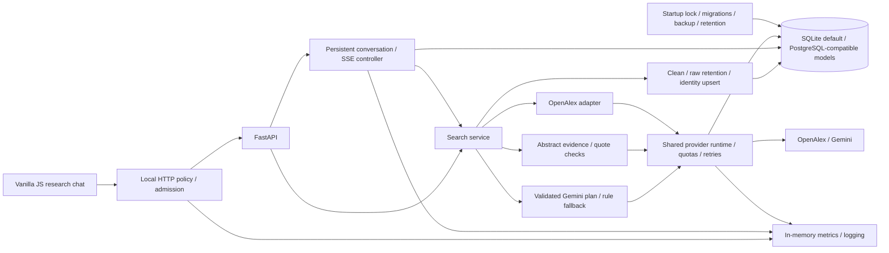

# Research Navigator — production readiness audit

**Later remediation, November 26:** [Current verification](../../VERIFICATION.md) records code fixes,
new test results and present deployment decisions. The original audit below remains unchanged in
meaning and describes its dated source/data snapshot. Later anonymous browser isolation does not
satisfy the internal employee-service access-control requirements.

**Audit date:** 2026-11-25. **Data observation:** 19:04:34 UTC. **Release inspected:** 0.2.0.
The workspace has no Git repository, so there is no commit SHA binding these observations to a release.
This is a personal, single-process application, not a deployed employee service. No application code
was modified to perform this audit. The private evidence bundle described by the [archive index](README.md)
contains logs, measurements, reproducible probes, Graphify output, and source checksums.

## Decision

| Deployment | Decision | Conditions and reasons |
|---|---|---|
| Supervised local learning prototype | **GO, limited to this purpose** | Keep loopback binding and one worker; maintain an independently verified manual backup. Disclose the date-filter, ranking, quality-KPI and automated-backup defects. This is not approval to depend on the automated backup or scientific accuracy. |
| Internal multiuser deployment | **NO-GO** | No authentication, authorization, user ownership or tenant isolation; single-process admission is not a shared-service design. |
| Enterprise production | **NO-GO** | Shared-service controls, verified deployment, durable monitoring/alerting, approved objectives, tested PostgreSQL recovery and scientific-quality evaluation are incomplete. |

The strongest confirmed defect is **acceptance of an empty SQLite file as the managed daily backup**.
The strongest result-correctness defects are **missing enforcement of year-only search bounds** and
**ranking after an unordered candidate cutoff**. Passing regression tests did not detect these cases.
See [prioritized gaps](GAP_ANALYSIS.md) for root causes and acceptance criteria.

## Method and status definitions

**PASS** means the stated, bounded check met its target. **FAIL** means a concrete requirement failed
or an essential deployment control is absent. **PARTIAL** means some useful behavior exists but
coverage, implementation or acceptance criteria are incomplete. **NOT VERIFIED** means the necessary
test, environment, labels or target was unavailable. Targets below are audit invariants, existing
configured gates, or explicitly identified deployment requirements; they are not invented SLAs.
Optional source-field completeness is reported without imposing an unsupported 100% target.

Evidence types are distinct: **real stored** metadata is checked read-only; **synthetic** fixtures are
invented explicitly for engineering tests; **mocked** provider responses exercise contracts/failures;
**live source** means an actual external request. Historical saved AI output is not fresh generation.

The implementation map and documentation were inspected first. Graphify indexed 52 code files into
614 nodes and 2,183 edges without LLM calls. It confirmed dependency paths through `create_app`,
`ResearchSearchService`, the repository, schemas, providers, chats and tests. Docker, YAML, lock files,
documentation and license references required direct inspection. Source paths are preserved in E13;
application/config hashes during report assembly are in E14.
The actual database schema was also inspected read-only: 13 tables including the revision ledger,
at revision `0002` (E16). E17 confirms the packaged load/recovery commands work; its later timings
are separate from the E08/E09 measurements used throughout this report.

## 1. Data acquisition

| Metric/control | Target | Actual result | Method/evidence | Status |
|---|---|---|---|---|
| OpenAlex request contract | Fixed backend endpoint; encoded filters/sort; validated envelope | Adapter uses `/works`, bearer key when configured, bounded 1–20 preview, validates result list/count | Source inspection; mocked contract and malformed-envelope tests; E01 | PASS |
| Current public connectivity | A real response, separately labeled | One anonymous GET returned 200; one result; integer count; 605.5 ms | Direct HTTPX request, E12 | PASS |
| Live application ingestion | Verify current complete network-to-database path | Prior saved evidence exists, but today's live probe was direct HTTPX and did not ingest | Scope distinction; E12 | NOT VERIFIED |
| Pagination | Full traversal only if claiming full acquisition | One page of up to 20; no cursor traversal | `openalex.py`, `schemas.py`; documented preview scope | PARTIAL |
| Rate limits | Avoid exceeding provider limits | Durable daily attempt limits and two concurrent calls/provider; no requests-per-second scheduler or response-budget synchronization | `providers.py`; quota/concurrency tests E01; official API reference below | PARTIAL |
| Timeouts/retries | Bounded operation and safe fallback | Default 20-second provider timeout, 60-second request deadline, at most two attempts; retryable status/GET faults tested | E01 provider deadline/retry tests | PASS |
| Ambiguous generation retries | Avoid blindly repeating a possibly billed request | Gemini transport errors are not retried; long Retry-After stops rather than retries early | E01 | PASS |
| Source reliability | Measured availability over an observation window | One successful live request is not an uptime estimate; only OpenAlex is integrated | E12; source registry | NOT VERIFIED |

The current [OpenAlex authentication documentation](https://help.openalex.org/api/authentication/)
supports bearer authentication and documents both daily and per-second limits. A concurrency semaphore
does not impose requests per second. [Cursor paging](https://help.openalex.org/api/paging/) is a separate
capability and is not implemented here. Preview-only behavior is honest, but cannot support a full-sync claim.

## 2. Data quality

| Dimension | Target | Actual result | Method/evidence | Status |
|---|---|---|---|---|
| External accuracy | Publisher/independent verification of material facts | No publisher/Crossref reconciliation performed | Provider agreement alone is not truth | NOT VERIFIED |
| Provider identity uniqueness | Zero duplicate work IDs | 0 / 116 duplicates; no duplicate non-null DOI groups observed | Read-only SQL, E04/E05 | PASS |
| Required traceability | Every stored work has raw identity evidence and retrieval time | 116 / 116 at work level | E04; historical run lineage is separate | PASS |
| Optional completeness | Measure missingness; preserve nulls | Titles/dates present for 116; abstracts 95/116; DOIs 113/116 | E04/E05 | PARTIAL |
| Field validity | Reject malformed identifiers/dates/counts | 126/126 stored raw records pass current validator; no negative counts | E05 and malformed-record tests E01 | PASS |
| Cross-field consistency | Conflicting year/date must be detected | 0 observed in corpus; synthetic year 1900/date 2026 accepted | E05/E06 | FAIL |
| Timeliness | Cache reuse within configured TTL; source freshness disclosed | Oldest retrieval 58.61 h; only 1/9 cache entries within reference 24 h | E04; runtime TTL rejection tested in E01 | PARTIAL |
| Completeness KPI | API and audit agree on missing values | API treats empty strings as present; reproduced with one blank record | E06 | FAIL |

An expired stored cache is not itself incorrect reuse. The runtime checks age; the corpus snapshot
does not prove fresh source coverage. See [data quality details](DATA_QUALITY_REPORT.md) for denominators.

## 3. Pipeline behavior

| Metric/control | Target | Actual result | Method/evidence | Status |
|---|---|---|---|---|
| Extraction/normalization | Preserve raw before cleaning; deterministic transformation | Raw JSON, DOI normalization, abstract reconstruction, missing counts and ordered authors exercised | E01; repository | PASS |
| Identity deduplication | One canonical work/provider ID; retain repeated raw observations | Native upserts; concurrent SQLite and repeat-refresh checks pass | E01; real uniqueness E05 | PASS |
| Chat idempotency | Replayed UUID does not repeat the command | Payload/key mismatch rejected; completed result can replay | E01 chat tests; E02 dropped-result tests | PASS |
| Run reconciliation | `received = rejected + valid`; `valid = duplicates + excluded_dates + usable` | Both equations hold for all three tracked runs; 30 received/valid/usable; zero rejected/duplicates | E04/E05 | PASS |
| Historical accounting | Complete attempt history with known stage counts | Only 3/15 ingestion rows have new counters; no fabricated backfill | E04 | PARTIAL |
| Date-bound enforcement | Revalidate all requested bounds against returned records | Year-only bound ignored by `matches_dates`; 1900 work returned for since-2022 query | E06; repository/service | FAIL |
| Incremental ingestion | Durable watermark/cursor/change checkpoint if claiming sync | Cache-based query refresh only; no scheduled incremental corpus synchronization | Architecture/source inspection | PARTIAL |
| Failure recovery | Errors visible; committed research preserved; claims released/recovered | Transport faults, partial previews, transaction rollback, disconnects, persistence failures, stale claims tested | E01/E04 | PASS |
| Silent data loss | Account for all received data, including crashes before commit | In-transaction rollback protects consistency; no crash/kill/disk-full campaign or durable pre-request ingestion ledger | E01 scope; ledger created during persistence | PARTIAL |

PASS for tested recovery paths does not imply coverage of arbitrary process or workstation failure.
Deduplication uses provider identity, not title similarity. Missing author IDs remain unknown; refreshing
their links can leave unreferenced author rows, as observed in E05.

## 4. Database

| Metric/control | Target | Actual result | Method/evidence | Status |
|---|---|---|---|---|
| Relational integrity | No FK violations; identity/author-order constraints | Zero FK violations; SQLite integrity `ok`; unique IDs and ordered link uniqueness defined | Models, migration inspection; E01/E04 | PASS |
| ACID behavior | Failed writes/migrations roll back without partial state | SQLite rollback and fresh-session retry tests passed | E01 | PASS |
| Database-level domain constraints | Protect validity outside application writes | No comprehensive CHECK constraints for nonnegative counters, roles/statuses, year/date consistency | Model/migration inspection | PARTIAL |
| Query plans | Index important predicates at intended corpus size | Keyword lookup scans publications; date sort scans plus temporary B-tree; no full-text index | SQLite EXPLAIN, E05 | PARTIAL |
| Versioned migration | Preserve records and roll back failed upgrade | Version 0002; preservation/repeat/failure tests pass | E01; E09 schema table present | PASS |
| Migration history independence | Old revisions do not change behavior with later application validation | Historical revisions import current helpers/validator; future drift risk, not a reproduced migration failure | Migration source inspection | PARTIAL |
| PostgreSQL runtime | Actual migration/concurrent transaction execution | Two integration tests skipped; DDL compilation is not runtime proof | E01/E12 | NOT VERIFIED |
| Manual SQLite recovery | Restored integrity, FK checks, row counts and readiness | All table counts matched, 116 publications/126 raw records; readiness 200 | E09 | PASS |
| Managed daily backup validity | A usable copy, not merely valid SQLite bytes | Existing zero-table file accepted as daily backup | E06 | FAIL |

Single-process locks, foreign-key PRAGMAs, thread-owned sessions and native upserts are useful controls.
The measured plans and small corpus do not establish performance at hundreds of thousands of works.

## 5. Governance and traceability

| Metric/control | Target | Actual result | Method/evidence | Status |
|---|---|---|---|---|
| Raw provenance | Original source payload, identity and retrieval time retained | Work-level coverage 100%; raw records preserved | E04/E05 | PASS |
| Run lineage | New raw records linked to the responsible ingestion run | 30/126 overall; historical 96 records unlinked; tracked equations reconcile | E04/E05 | PARTIAL |
| Transformation/model traceability | Reconstruct exact effective request, transform version, model/prompt and outcome | Activity/query snapshots exist; no complete immutable transformation/model/prompt-version ledger | Models, chats, answerer | PARTIAL |
| Retention | Enforced policy and deletion scope disclosed | 30-day inactive chats; seven-day managed SQLite backup policy; active chats/research protected in tests | E01, operations docs | PASS |
| Growth/author lifecycle | Explicit lifecycle for retained technical/research rows | Raw research retained indefinitely; 39 orphan authors; no archive/compaction strategy | E05 and code inspection | PARTIAL |
| Licensing | Document integrated-source and publication rights separately | Source registry exists; raw location metadata preserved; no complete field-level licensing inventory/operational review | Source registry and raw schema | PARTIAL |

[OpenAlex describes its data as CC0](https://openalex.org/transparency). This does not establish rights
to every linked publication or full text. The app does not fetch PDFs. Location-level source/license
details, where supplied, stay in raw JSON rather than a dedicated cleaned licensing model.

## 6. Performance and capacity

No approved latency, memory or throughput SLO exists; results are observations, not promises.

| Workload | Successful / attempts | P50 / P95 / P99 ms, successes only | Successful requests/s | Cache hits | Evidence |
|---|---:|---|---:|---:|---|
| Existing synthetic benchmark, 5 clients | 20 / 20 | 35.46 / 41.10 / 41.10 | 113.85 | 20/20 | E04 |
| Instrumented ASGI, 1 client | 100 / 100 | 21.74 / 26.66 / 27.44 | 44.39 | 100/100 | E08 |
| Instrumented ASGI, 5 clients | 100 / 100 | 92.38 / 162.58 / 188.31 | 47.03 | 100/100 | E08 |
| Instrumented ASGI, 10 clients | 5 / 100 | 213.18 / 218.50 / 218.50 | 22.11 | 5/5 successes | E08 |

Ten-client admission rejected 95/100 requests with 429. The reported 442.24 total attempts/s includes
these fast rejections and must not be called useful throughput. All admitted responses in this small
workload succeeded; the saturated percentiles have only five samples. No percentile comparison above
is evidence of a speedup: the workloads, tracing overhead and simultaneous machine activity differ.

Process RSS samples ranged from about 83.0 to 88.8 MiB. Peak tracemalloc allocations were 618,011,
783,344 and 528,013 bytes in the respective workloads; Python heap instrumentation is not total RSS.
These are point/short-run measurements, not a leak/soak test or process peak guarantee. There is no
network/socket load, large-corpus test, proxy/TLS test, or sustained provider latency distribution.

**Status:** bounded admission and cached short-run behavior **PASS**; capacity/SLO and long-run memory
claims **NOT VERIFIED**; local relevance correctness **FAIL** because E06 omitted the strongest match.

## 7. Reliability and recovery objectives

| Metric/control | Target | Actual result | Method/evidence | Status |
|---|---|---|---|---|
| Persisted ingestion success | Report complete denominator and scope | 15/15 stored ingestion rows say succeeded; not an all-attempt availability statistic | E04 | PARTIAL |
| Tested application error behavior | Explicit errors/fallback rather than silent success | Offline failure injections and 20-request outage/invalid-input cases pass | E01/E04 | PASS |
| Observed load response mix | Report every attempted response | At 1/5 clients: zero non-200; at 10: 95% rejected; zero other statuses | E08, workload-specific only | PASS |
| Exported error accounting | Count rejected requests as well as admitted ones | 15 actual HTTP 429 responses absent from request metrics | E07 | FAIL |
| RTO | Business-approved recovery duration and repeated operational drill | No objective; one restore-through-ready drill 199.42 ms | E09 | NOT VERIFIED |
| RPO | Approved loss window and measured backup freshness/off-device recoverability | No verified loss window or off-device restore; nominal daily schedule is insufficient proof | Backup defect E06 | NOT VERIFIED |
| Failure domains | Recover from workstation/storage/process failure | Manual local restore exercised; no durable queue, HA, offsite drill or destructive crash campaign | Code/operations inspection | PARTIAL |

Backup creation took 62.45 ms and restore 53.71 ms. The 199.42 ms measurement begins at restore
invocation and includes application startup/readiness against the restored temporary database; it
excludes incident detection, human action, obtaining media, network recovery and traffic switching.

## 8. AI evaluation

| Metric/control | Target | Actual result | Method/evidence | Status |
|---|---|---|---|---|
| Precision@K | Defined K, judged relevant returned works / returned works | No labeled real query set; no score | Human-review rubric exists, E10 does not supply relevance labels | NOT VERIFIED |
| Recall@K | Relevant retrieved / complete judged relevant universe | No reference universe; OpenAlex match count is not that denominator | Source/corpus limitations | NOT VERIFIED |
| Citation identity/quote validity | Every emitted citation identifies supplied evidence with a matching quote | Invalid/uncited output rejected in mocked tests; historical snapshot 3/3 mechanical matches | E01/E10 | PASS |
| Current-corpus citation rate | Nonempty inspected claim denominator | 0 claims and 0 citations in current chats; rate undefined | E04 | NOT VERIFIED |
| Faithfulness | Claim meaning supported by cited evidence | Exact substring checks only; no entailment/human evaluation | Answerer and rubric | NOT VERIFIED |
| Hallucination rate | Unsupported claims / reviewed claims, with adjudication | No reviewed claims denominator; no score | Rubric remains unfilled | NOT VERIFIED |
| Planning safety | Narrow validated parameters; no model SQL/execution | Pydantic validation, fixed backend tools and bounded history/evidence | E01; schemas/interpreter | PASS |
| Fallbacks | Honest rules, excerpts, missing-evidence and quota handling | Wrong IDs/quotes, malformed JSON, missing abstracts, timeouts and budgets exercised | E01/E02 | PASS |
| Fresh Gemini availability | Actual current generation and grounded answer | No new Gemini request in this audit; saved output is historical | E10/E12 | NOT VERIFIED |

The three historical claims are not three scientifically validated claims. Quote membership can
pass for a true quotation attached to a false interpretation. A separate human-reviewed evaluation
set is required before reporting faithfulness, retrieval accuracy or hallucination percentages.

## 9. Security

| Control | Target | Actual result | Method/evidence | Status |
|---|---|---|---|---|
| Secret boundary | Keys backend-only; not in responses, logs or browser source | Configuration hides key/DB repr; fixed server headers; leakage tests pass; no secret values copied into evidence | E01 and source inspection | PASS |
| Input/SQL safety | Structured validation and parameterized queries | SQLAlchemy parameters; work IDs and fields bounded; malformed/adversarial inputs tested | E01/E02 | PASS |
| Browser content safety | Untrusted source/model text not executed | Text-node rendering, safe-link protocol restriction and CSP; DOM tests and browser checks pass | E02/E03 | PASS |
| Local request policy | Reject unwanted hosts/origins/content types/oversize bodies | Tests pass; JSON body cap 64 KB; loopback deployment documented | E01 | PASS |
| Vulnerability audit | No known vulnerabilities in audited locked runtime dependencies | 27 Python packages: zero known; npm: zero across severities | E11; point-in-time advisory queries | PASS |
| Authentication/authorization | Required for shared users and private records | Absent; no principals, ownership checks or per-user isolation | Models/routes/config | FAIL for shared deployments |
| TLS/encryption/secrets operations | Required shared-service transport/storage/rotation policy | No enforced application TLS, backup encryption, central secret rotation or access audit | Inspection, no enterprise environment | PARTIAL |
| Broader security assurance | Explicit threat model and testing depth | No penetration test, fuzzing campaign, container scan or dependency artifact attestation | Audit scope | NOT VERIFIED |

Local Host/Origin policy is not authentication and does not protect a server intentionally exposed
to a network. No internal/enterprise approval follows from the local security PASS rows.

## 10. Observability

| Metric/control | Target | Actual result | Method/evidence | Status |
|---|---|---|---|---|
| Structured operational logs | Content-safe request IDs, route, outcome, duration emitted by default | JSON INFO record constructed, but `research_navigator` INFO disabled under default Uvicorn config | E07 | FAIL |
| Request metrics | Every response, including policy/admission rejects | Rejections return before metric finalizer; 15 missing 429s | E07 | FAIL |
| Cache hit/miss metrics | Consistent accounting across supported search endpoints | Chat emit records decisions; standalone `/api/search` did not emit cache metric lines | E07; service caller inspection | PARTIAL |
| Provider/stage telemetry | Bounded labels; latency/attempts/usage without secrets | Provider attempt/token and chat-stage tests pass | E01 | PASS |
| Health/readiness | Separate liveness from database check; safe 503 on DB failure | Endpoints and injected database-failure test pass | E01/E09 | PASS |
| Traceability | Correlated activity across a saved turn | Request UUID and durable SSE events exist; not distributed tracing | E01/E02 | PARTIAL |
| Alerting/storage | Durable telemetry and tested actionable notifications | No scraper, persistence, alert rules or delivery tests; in-memory metrics reset on restart | Inspection | FAIL for operated shared service |

HTTP 200 on an SSE stream can still contain a failed research turn; HTTP status alone is not pipeline
success. Operational dashboards must combine terminal run outcomes, provider failures and admission counts.

## 11. Testing

| Gate | Target | Actual result | Method/evidence | Status |
|---|---|---|---|---|
| Regression/SQLite integration | All selected tests pass | 224 passed, 2 skipped; 93.15 s | E01 | PASS |
| Combined coverage | Existing configured minimum 80% | 93.18%; 1,748/1,843 lines and 506/576 branches | E01 | PASS |
| Frontend state/stream behavior | All selected cases pass | 33 passed, zero failed | E02 | PASS |
| Browser/accessibility journeys | Desktop/mobile selected journeys and automated axe assertions pass | Four Chromium tests passed in 46.1 s | E03 | PASS |
| Backup/restore script tests | Selected isolated operation cases pass | Two passed | E12; `scripts/test_operations.py` | PASS |
| Fault/data quality coverage | Success, edge and error paths represented | Retries, budgets, FK checks, rollback, stale claims, cache damage, malformed data and missing evidence covered | E01 | PASS within tested scope |
| Adversarial audit probes | Important edge invariants hold | Four main defects plus consistency/observability gaps reproduced outside suite | E06/E07 | FAIL |
| Load/soak/chaos | Intended deployment environment and duration exercised | Short synthetic ASGI tests only; no sockets, long soak or storage/power failure | E08 | PARTIAL |

Coverage is not a completeness proof. In this run `database.py` was 73% covered and `main.py` 81%;
the unexecuted PostgreSQL/platform branches are material. Automated axe checks are not a complete
assistive-technology audit. Only Chromium was exercised.

## 12. Deployment and reproducibility

| Control | Target | Actual result | Method/evidence | Status |
|---|---|---|---|---|
| Locked environment | Explicit runtime/dev selections and repeatable npm install | Python versions pinned without wheel hashes; npm lock includes integrity; only Windows/Python 3.13.7 tested here | Locks, E12 | PARTIAL |
| Container configuration | Nonroot, bounded local exposure, readiness, persisted data | Image source sets uid 10001 and SQLite `/data`; Compose uses PostgreSQL, loopback ports and hardening | Dockerfile/Compose inspection | PARTIAL |
| Actual container execution | Build, nonroot/runtime readiness and persistence verified | Docker daemon/config access denied | E12 | NOT VERIFIED |
| CI execution | Successful matrix, PostgreSQL, browser, audit and container jobs | Workflow source exists; no Git repository or remote run evidence | E12; workflow inspection | NOT VERIFIED |
| CD/release controls | Controlled release, rollback, provenance | Manual artifact packaging configured; no publishing/deployment; floating image/action tags, no signed release/SBOM evidence | Workflow/Docker inspection | PARTIAL |
| Production configuration | Controls appropriate to named deployment | One worker/local scope explicit; defaults are not approved multiuser/enterprise configuration | Config/operations docs | PARTIAL |

No deployment was attempted. The Python 3.11–3.13 CI matrix is configured source, not three verified
local interpreter results. SQLite rollback and manual restoration do not substitute for PostgreSQL tests.

## 13. Visualization and user-facing interpretation

| Control | Target | Actual result | Method/evidence | Status |
|---|---|---|---|---|
| Filters/sorting interface | Explicit controls override inferred values; inclusive date presets | Contract and DOM/browser cases pass | E01/E02/E03 | PASS within tested cases |
| Filter/rank result correctness | Every returned record meets constraints; ranking considers intended set | Year-bound and relevance-cutoff probes fail | E06 | FAIL |
| KPI correctness | Defined denominator, blank handling and accurate scope | Quality API blank handling fails; current stored optional-field totals still reported separately | E04/E06 | FAIL |
| Freshness display | Publication and retrieval time distinguished | Paper/details/cached responses expose timestamps; local fallback has no unified age KPI | Frontend/source inspection and E03 | PARTIAL |
| Corpus coverage | Preview/local subset never presented as all research | Warnings and counts distinguish preview/local fallback; no all-OpenAlex completeness measure | E02/E03; source inspection | PASS |
| AI evidence experience | Sources and uncertainty inspectable in the same chat | Citation disclosure, no-abstract fallback, saved history and activity tested | E01/E02/E03 | PASS for interaction, not semantic truth |

There is no standalone analytical KPI dashboard or research-corpus visualization to certify. The
quality API and research interface are the available surfaces. Selection of the most important papers
is not scientifically validated by citation counts or a polished interface.

## Required next evidence

Before relying on automated recovery or result correctness, resolve G01–G05 in the
[gap analysis](GAP_ANALYSIS.md) with regression tests. Before operating a shared service, implement
identity/ownership controls, approved objectives, complete telemetry and tested recovery, then execute
PostgreSQL/container/remote-CI gates and labeled scientific-quality evaluation. This audit did not fix
or close those items. The [engineering scorecard](ENGINEERING_SCORECARD.md) contains claims safe to
use in an interview, and the [learning guide](../../../LEARNING_GUIDE.md) explains the concepts and failure cases.
